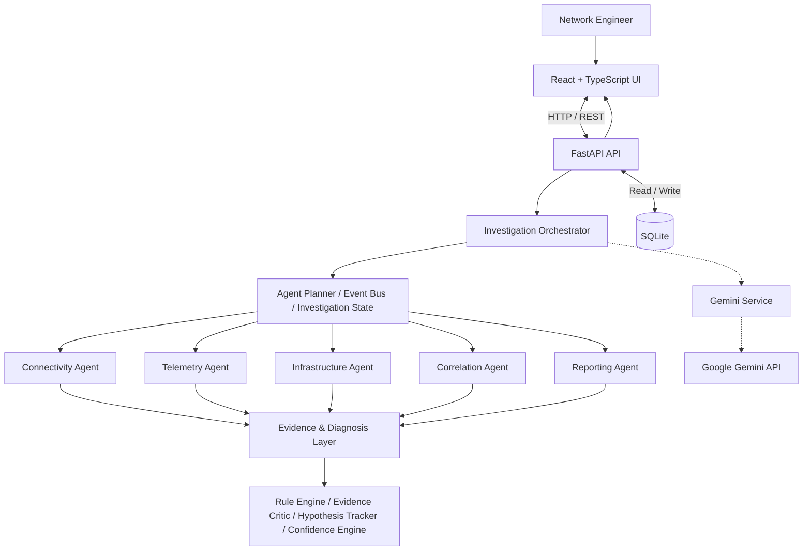
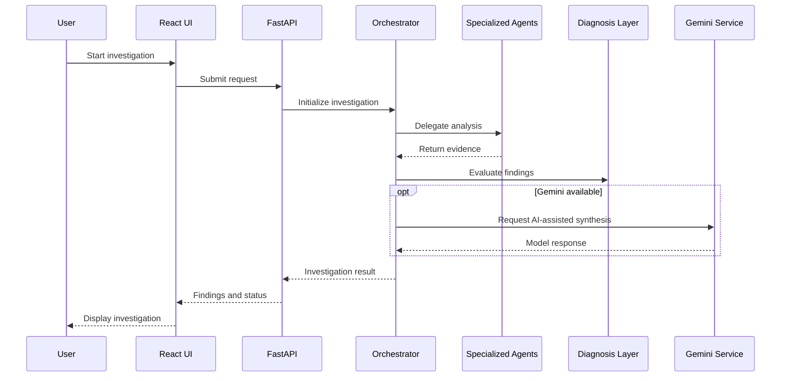

# NetCoop AI

### Multi-Agent Network Incident Investigation & Root Cause Analysis

**NetCoop AI** is a hackathon project exploring how specialized AI agents, network evidence, and explainable diagnosis workflows can help engineers investigate complex network incidents.

[](https://www.python.org/)
[](https://fastapi.tiangolo.com/)
[](https://react.dev/)
[](https://www.typescriptlang.org/)
[](https://ai.google.dev/)

> **Project goal:** Turn fragmented network signals into a coordinated, evidence-driven investigation with understandable findings.

## The Problem

Diagnosing a network incident often requires examining connectivity, telemetry, infrastructure state, and conflicting evidence across multiple systems. Manual investigation can be slow, and a single AI model may overlook important perspectives or provide an answer without enough supporting evidence.

NetCoop AI approaches the problem as a **multi-agent investigation**: specialized components examine different aspects of an incident, share evidence, and contribute to a consolidated diagnosis.

## Key Capabilities

- **Specialized investigation agents** for connectivity, telemetry, infrastructure, correlation, and reporting.
- **Agent orchestration** with a planner, event bus, and investigation state.
- **Evidence-oriented diagnosis** using rule evaluation, hypothesis tracking, evidence critique, and confidence assessment components.
- **Gemini integration** for AI-assisted analysis when the configured model is available.
- **Visual investigation interface** for network topology, telemetry, timelines, evidence comparison, and agent activity.
- **Local persistence** using SQLite.

> These describe the project's architecture and intended workflows. Exact behavior depends on the implementation and available data sources.

## System Architecture



*Conceptual architecture: the diagram illustrates component responsibilities and relationships, not a verified call-by-call execution trace.*

## Multi-Agent Design

| Agent | Investigation focus |
| --- | --- |
| **Connectivity Agent** | Connectivity symptoms and reachability evidence |
| **Telemetry Agent** | Metrics, signals, and anomalous observations |
| **Infrastructure Agent** | Network and infrastructure context |
| **Correlation Agent** | Relationships and inconsistencies across evidence sources |
| **Reporting Agent** | Summarizing findings for the investigation report |

The supporting orchestration and reasoning modules coordinate work, validate information, track hypotheses, and organize results.

## Investigation Flow



*Illustrative workflow; consult the implementation for exact sequencing.*

## Technology Stack

| Layer | Technology |
| --- | --- |
| Frontend | React 18, TypeScript, Vite |
| UI / visualization | React Flow (`@xyflow/react`), Recharts, Lucide React, Tailwind CSS |
| Backend | Python, FastAPI, Uvicorn, Pydantic |
| AI integration | Google Gemini via `google-genai` |
| Data | SQLite, SQLAlchemy, aiosqlite |
| Testing | pytest, pytest-asyncio, httpx |
| Local tooling | npm, Python virtual environment, Docker Compose configuration |

## Repository Structure

The **published GitHub repository** currently places frontend and backend code at the root:

```text
agentic_ai_hacthon/
├── app/                 # Python application
├── src/                 # React / TypeScript source
├── generator/           # Project generators / supporting code
├── scenarios/           # Scenario assets
├── tests/               # Tests
├── dist/                # Frontend build output
├── index.html
├── package.json
├── package-lock.json
├── requirements.txt
├── vite.config.ts
├── tsconfig.json
├── docker-compose.yml
└── README.md
```

**Note:** A separate local working copy may use `backend/` and `frontend/` directories. The instructions below target the repository structure shown above.

## Getting Started

### Prerequisites

- Python 3.12 or another compatible Python 3 version
- Node.js and npm
- Git
- A Google Gemini API key if you want to enable Gemini-powered features

### 1. Clone the repository

```bash
git clone https://github.com/Mukesh-kr-chauhan/agentic_ai_hacthon.git
cd agentic_ai_hacthon
```

### 2. Install and start the backend

**Windows CMD:**

```cmd
python -m venv .venv
.venv\Scripts\activate
python -m pip install -r requirements.txt
python -m uvicorn app.main:app --reload
```

Backend URL: **http://127.0.0.1:8000**  
Interactive API documentation: **http://127.0.0.1:8000/docs**

### 3. Install and start the frontend

Open a **second terminal** in the repository root:

```bash
npm install
npm run dev
```

Open the local URL printed by Vite, typically **http://localhost:5173**.

### 4. Configure Gemini (optional)

Provide the API key through the environment configuration expected by your backend. For example, if your local configuration loads a `.env` file:

```dotenv
GOOGLE_API_KEY=your_google_gemini_api_key
ENABLE_GEMINI=true
GEMINI_MODEL=your_supported_model_name
GEMINI_TIMEOUT_SECONDS=30
GEMINI_MAX_RETRIES=2
DATABASE_URL=sqlite:///./netcoop.db
FRONTEND_URL=http://localhost:5173
```

Use a model confirmed to work with your API key. Model listings and availability can change. **Never commit a real `.env` file or API key to GitHub.**

> If the repository's backend does not automatically load `.env`, export these variables in your shell or add environment loading in the application's configuration before startup.

## Development Commands

| Task | Command |
| --- | --- |
| Start backend | `python -m uvicorn app.main:app --reload` |
| Start frontend | `npm run dev` |
| Build frontend | `npm run build` |
| Preview frontend build | `npm run preview` |
| Run backend tests | `python -m pytest` |

## Gemini Availability and Fallback

Gemini is an external service. A valid API key does not guarantee that every model is available or responsive.

- **404 / model unavailable:** Choose a supported model for your API key and API version.
- **503 UNAVAILABLE:** The model may be experiencing temporary demand; retry with backoff or test another supported model.
- **Empty verification response:** Inspect the response and token configuration rather than treating an empty string as proof that credentials are invalid.
- **Fallback mode:** Indicates AI-assisted processing is unavailable or restricted; it should not be presented as a successful Gemini result.

Keep API keys out of logs, screenshots, issues, and commits.

## User Interface

The frontend is organized around investigation-focused visualizations, including:

- Network topology
- Telemetry charts
- Incident timeline
- Agent workflow graph
- Agent debate panel
- Evidence comparison
- Investigation replies and reports

*Add verified screenshots or a short demo GIF here once available.*

## Future Improvements

- Integrate additional real network telemetry sources.
- Improve retries, health checks, and resilience around external AI services.
- Add richer evidence provenance and audit trails.
- Expand scenario-based and end-to-end testing.
- Harden deployment, observability, and secret management.

## Contributing

Contributions, bug reports, and improvement ideas are welcome through GitHub issues and pull requests.

## Repository

**GitHub:** https://github.com/Mukesh-kr-chauhan/agentic_ai_hacthon

---

**NetCoop AI — Turning Network Complexity into Explainable Intelligence.**
